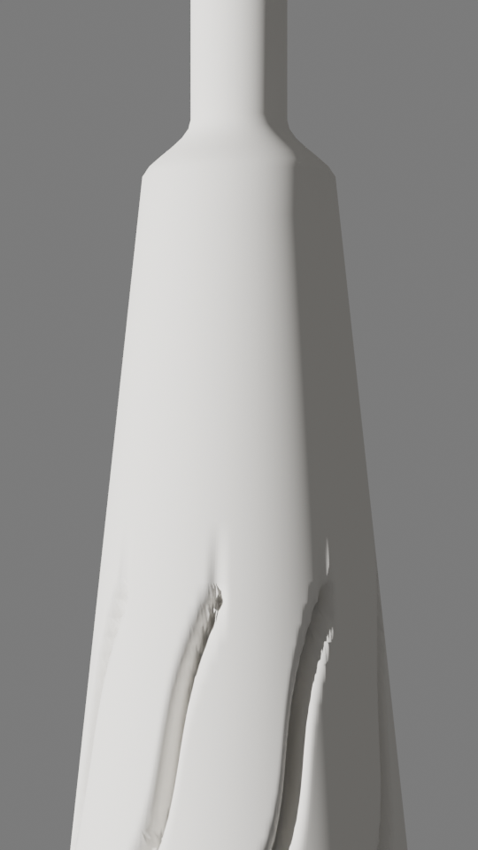
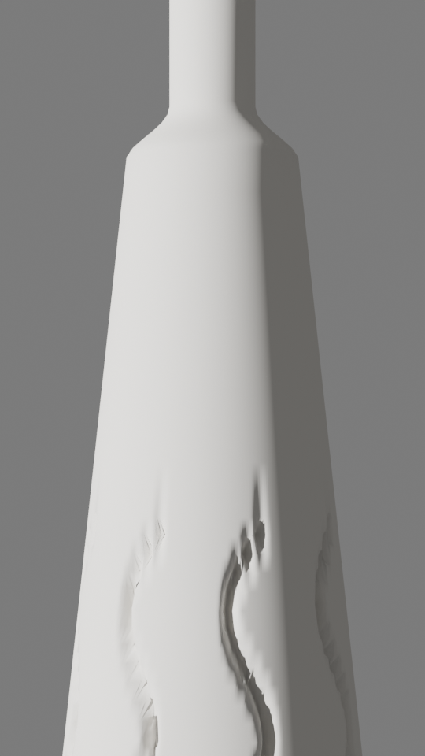
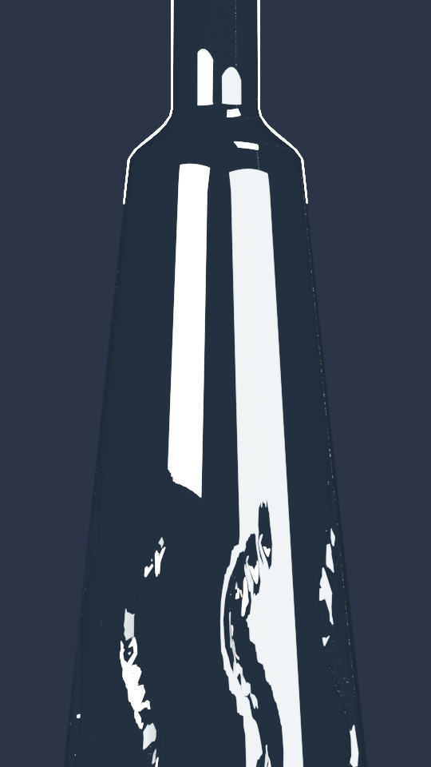
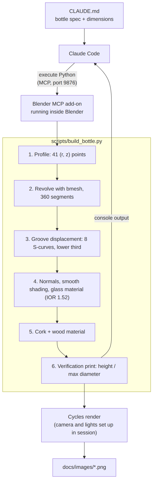
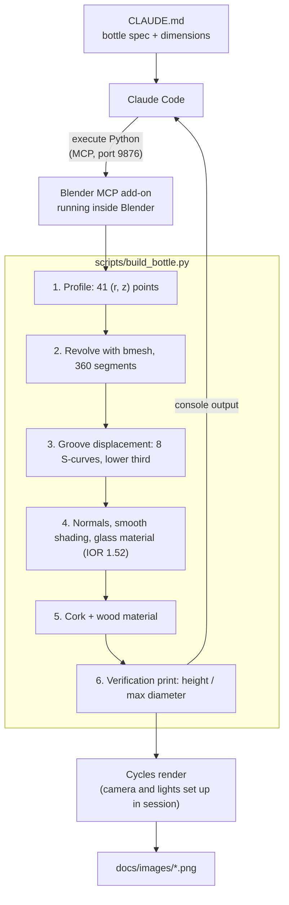

# Blender MCP Modeler

A Blender Python script, driven by Claude Code through the Blender MCP server, that builds a real-scale model of a tapered glass bottle with engraved agave-leaf grooves.

  

## What it does

Modeling a product bottle by hand from a technical drawing is slow to iterate: every change to a dimension or to the surface pattern means redoing edits in the viewport. Here the bottle is one idempotent Python script. Claude Code reads the spec in `CLAUDE.md`, runs the script inside a live Blender session through the Blender MCP server, reads back the verification output, and adjusts parameters until the render matches the reference. The script revolves a 2D profile into the glass body, displaces eight S-shaped grooves into the lower third, and adds a glass material and a cork.

## Demo

Renders from Blender's Cycles engine. Framing crops the cork and the base.

| Clay, groove detail | Clay, front | Glass |
|---|---|---|
|  |  |  |

Console output of a run (the script's own verification block):

```text
Perfil: 41 pts | 14762 verts
Surcos desplazados: 1328 verts
=== VERIFICACIÓN ===
  Altura vidrio: 28.0cm  (ref: 28cm)
  Diámetro max:  9.0cm  (ref: 9cm)
  Surcos: 8 | TWIST=28° WAVE=14° HA=5°
  Zona relieve: Z=2.5-11.0cm
```

## Architecture





- **Spec.** `CLAUDE.md` holds the bottle specification: silhouette, a dimension table in centimeters, groove placement, glass and cork materials, lighting and render setup. Claude Code loads it at the start of every session.
- **Transport.** Claude Code sends Python to Blender through the Blender MCP add-on, which listens on port 9876 inside the running Blender instance. The script's `print` output comes back as the tool result.
- **Profile and revolve.** The script builds a list of `(radius, height)` points for the foot, body, shoulder, neck and collar. It then revolves that list into a closed mesh with `bmesh`, one segment per degree.
- **Grooves.** The script pushes vertices in the lower third of the body toward the axis. Each groove follows a twisted S-curve, and its cross-section is shaped by a cosine-squared falloff.
- **Materials and cork.** The script assigns a Glass BSDF (IOR 1.52, slight blue-green tint) to the body, and adds a cylinder cork with a Principled BSDF wood color.
- **Verification.** The script prints the bounding-box height and maximum diameter next to the reference values, so Claude can confirm the dimensions without looking at a render.

## Tech stack

- **3D:** Blender 4.2 LTS, Python API (`bpy`), `bmesh` for mesh construction, Cycles for rendering
- **Agent:** Claude Code with the Blender MCP server ([ahujasid/blender-mcp](https://github.com/ahujasid/blender-mcp)), which runs Python in the live Blender session
- **Language:** Python 3 (standard library `math` only; no third-party packages)

## Key design decisions

**One idempotent script as the source of truth** — The whole model lives in `build_bottle.py`, which deletes `BottleBody` and `Cork` and rebuilds them on every run. The alternative was issuing many small MCP calls that each edit the scene. With a single script, every iteration is reproducible and diffable, and a parameter change is just a re-run. The cost is that there is no non-destructive modifier stack to tweak in the Blender UI: changes go through the constants in the script.

**Hand-built profile revolved with `bmesh`** — The body is a list of `(r, z)` points with explicit easing curves for the foot and shoulder, revolved in code. The alternatives were a Screw modifier on a drawn curve, or sculpting. Point values come straight from the spec's dimension table, in real-world units (1 cm = 0.01 m). Point spacing is 0.5 cm in the groove zone and 1.5 cm above it, so detail goes where the grooves need it. The cost is density: 360 segments produce 14,762 vertices for what is mostly a smooth cone.

**Grooves as analytic vertex displacement** — Each vertex in the groove band is moved inward by a depth computed from its angular distance to the nearest groove centerline. The alternatives were Boolean cuts or a bump/normal map. With displacement, the grooves are real geometry: they refract through Cycles glass and change the silhouette, which a bump map would not. It also avoids Boolean cleanup artifacts. The cost is that groove sharpness depends on mesh resolution (1° × 0.5 cm), and because the groove width is an angle (5°), the grooves narrow as the body tapers.

**Self-checking output instead of visual inspection** — The script ends by printing the measured height and maximum diameter next to the reference values. The alternative was judging dimensions from a render or viewport screenshot. Claude reads this text through MCP and can confirm the model is to scale in one call. The trade-off is that it only checks the bounding box, not groove depth or the shape of the profile curve.

## Results

- The measured height is 28.0 cm and the maximum diameter is 9.0 cm, both matching the spec (verification output above).
- The mesh has 14,762 vertices and 15,120 faces, and 1,328 vertices are displaced to form the grooves.
- A full rebuild takes under 0.1 s headless (Blender 4.2 `bpy` module on a 2-core cloud VM). Consecutive runs leave exactly one `BottleBody` and one `Cork` in the scene.
- [TODO: metric — Cycles render time per frame and sample count for the glass render]
- [TODO: metric — number of Claude Code iterations from first profile to the final 8-groove version]

## Getting started

**Prerequisites**

- Blender 4.2 LTS or later
- [Claude Code](https://docs.claude.com/en/docs/claude-code) and [uv](https://docs.astral.sh/uv/) (for `uvx`)

**1. Install the Blender MCP add-on.** Run `uvx blender-mcp install-addon`, or install `addon.py` from [ahujasid/blender-mcp](https://github.com/ahujasid/blender-mcp) via *Edit → Preferences → Add-ons*. Then enable the add-on. In the 3D Viewport sidebar (`N`), open the add-on's tab and click **Connect to Claude**. The server listens on port 9876 by default. Menu labels vary between add-on versions, so follow that repository's README if yours differ.

**2. Register the MCP server with Claude Code** from the repository root:

```bash
git clone https://github.com/hectorgarciaalmaraz/blender-mcp-modeler.git
cd blender-mcp-modeler
claude mcp add blender -- uvx blender-mcp
```

**3. Build the bottle.** Delete Blender's default cube first: the script only removes its own objects, and the cube encloses the bottle. Then start `claude` in the repository and ask it to run `scripts/build_bottle.py` in Blender. Claude reads `CLAUDE.md`, sends the script over MCP and reports the verification block.

**Without MCP** — you can run the same script from Blender's *Scripting* workspace, or headless:

```bash
blender --background --factory-startup \
  --python-expr "import bpy; bpy.data.objects.remove(bpy.data.objects['Cube'])" \
  --python scripts/build_bottle.py \
  --python-expr "import bpy; bpy.ops.wm.save_as_mainfile(filepath='bottle.blend')"
```

Open `bottle.blend`, add a camera and lights, set the render engine to Cycles, and render.

## Project structure

```text
blender-mcp-modeler/
├── CLAUDE.md                 bottle spec and session rules Claude Code loads
├── scripts/
│   └── build_bottle.py       profile → revolve → grooves → materials → cork → verification
├── docs/
│   └── images/               architecture diagram and Cycles renders
├── LICENSE                   MIT
└── README.md
```

## Limitations

- **One model.** Dimensions and groove parameters are constants in the script. There is no config file or CLI, so a different bottle means editing the code.
- **Solid glass.** The body is a single closed shell with no wall thickness and no interior. Cycles refracts it like a solid block of glass, not a hollow bottle. The liquid in the spec is not modeled.
- **Simplified cork.** It is a flat-topped cylinder with a flat color. The spec's rounded top and wood texture are not implemented.
- **No labels.** The label phase in `CLAUDE.md` has not been started.
- **Render setup is not in the repo.** Camera, lights, background and Cycles settings for the renders above were set up interactively over MCP and are not scripted. The framing also crops the cork and the base.
- **Scene assumptions.** The script does not clear the rest of the scene. The default cube, or any other object, stays in place.
- **Tuned by eye.** Groove count, twist and depth were chosen by comparing renders with the reference. There is no automated check beyond the bounding box.
- **Spanish in the code.** Comments and console output in `build_bottle.py` are in Spanish.
- **No reference images.** The technical drawings used as reference are not included.
